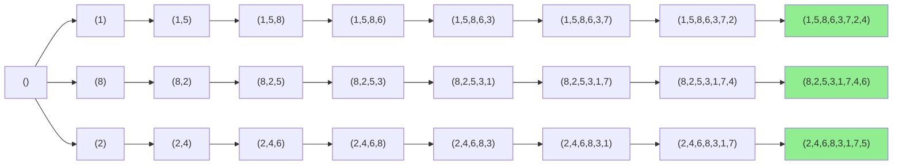

# Darea de seamă – Lucrare de laborator: Reprezentarea problemei și căutarea în spațiul stărilor

**Varianta 3:** Problema celor 8 regine
**Limbaj / mediu:** Java 11+ (un singur fișier `EightQueensLab.java`, Maven, IntelliJ IDEA / VS Code / Eclipse)

---

## 1. Scopul lucrării

Însușirea modului de reprezentare a unei probleme ca **spațiu al stărilor** (graf de tranziții) și compararea strategiilor de căutare: oarbă (DFS, BFS), euristică (A\*), căutare inversă și strategie mixtă.

**Problema:** să se amplaseze 8 regine pe o tablă de șah 8×8 astfel încât nicio pereche să nu se atace (nici pe linie, nici pe coloană, nici pe diagonală).

## 2. Reprezentarea problemei

### 2.1 Codificarea stărilor

O stare este un tuplu

$$
s = (q_1, q_2, \dots, q_k), \qquad 0 \le k \le 8,\; q_i \in \{1,\dots,8\}
$$

unde indicele $i$ este **coloana**, iar $q_i$ – **linia** reginei din coloana $i$. Prin construcție, în fiecare coloană există cel mult o regină, ceea ce elimină o clasă întreagă de conflicte și reduce spațiul de căutare.

| Element al modelului | Definiție |
|---|---|
| Starea inițială $S_0$ | `()` – tabla goală |
| Operatorul de tranziție | adaugă o regină în coloana $k+1$ pe linia $r\in\{1..8\}$ |
| Condiția de tranziție `Safe(s, r)` | $r \ne q_i$ și $\lvert q_i - r\rvert \ne \lvert i-(k+1)\rvert$ pentru toți $i\le k$ |
| Starea țintă $S_G$ | $k = 8$ și starea este validă |
| Costul tranziției $C(s,s')$ | 1 |
| Operatorul invers | șterge regina din ultima coloană completată |

Exemplu de verificare a tranziției (fragment din cod):

```java
public static boolean isValidTransition(State state, int newRow) {
    int newCol = state.size() + 1;
    for (int i = 0; i < state.size(); i++) {
        int col = i + 1, row = state.getRow(i);
        if (row == newRow || Math.abs(row - newRow) == Math.abs(col - newCol))
            return false;           // conflict pe linie sau diagonală
    }
    return true;
}
```

### 2.2 Graful stărilor

Spațiul stărilor este graful orientat $G=(V,E)$, unde $V$ sunt stările valide, iar $E$ – tranzițiile permise. În program este clasa `StateGraph` (listă de adiacență `Map<State, List<State>>`). Clasa `State` este imuabilă, cu `equals`/`hashCode` pe conținutul tuplului, deci poate fi folosită în `HashSet`/`HashMap`.

### 2.3 Dimensiunea spațiului stărilor

Numărul stărilor valide pe fiecare nivel $k$ (cu pruning-ul `Safe`):

| k | 0 | 1 | 2 | 3 | 4 | 5 | 6 | 7 | 8 |
|---|--:|--:|--:|--:|--:|--:|--:|--:|--:|
| Stări valide | 1 | 8 | 42 | 140 | 344 | 568 | 550 | 312 | **92** |

Total: **2057** de stări; la nivelul 8 se află cele **92 de soluții** cunoscute ale problemei. Pentru comparație, fără verificarea conflictelor ar exista $8^8 = 16\,777\,216$ de configurații.

## 3. Strategiile de căutare implementate

| Strategie | Idee | Structura de date |
|---|---|---|
| **DFS** | extinde cel mai adânc nod; succesorii sunt puși în stivă în ordine inversă, deci se încearcă linia cea mai mică prima | stivă (`ArrayDeque`) + mulțime `visited` |
| **BFS** | extinde nivel cu nivel | coadă (`ArrayDeque`) + `visited` |
| **A\*** | prioritizează după $f(s)=g(s)+h(s)$, cu $g(s)=k$ | `PriorityQueue`, `gScore`, `visited` |
| **Căutare inversă** | pornește de la $S_G$ și aplică operatorul invers până la $S_0$ | – |
| **Strategie mixtă** | regulă directă pentru primele 4 coloane + A\* pentru restul | – |

### 3.1 Funcția euristică $h(s)$

Euristica folosește **forward checking**: pentru fiecare coloană încă necompletată se numără celulele libere (neatacate de reginele deja puse).

- dacă o coloană viitoare nu mai are nicio celulă liberă → $h=+\infty$ (starea este o fundătură și se taie din căutare);
- altfel:

$$
h(s) = (8-k) - 0{,}05\,k + \frac{\text{celule atacate}}{1000}
$$

Primul termen estimează numărul de pași rămași, al doilea favorizează stările mai adânci, iar al treilea departajează după numărul de celule blocate. La egalitate de $f$ se preferă starea mai adâncă.

### 3.2 Căutarea inversă

Din starea țintă se aplică repetat `removeLast()` până se ajunge la `()`; la fiecare pas se verifică validitatea stării.

### 3.3 Strategia mixtă

Primele 4 coloane se completează direct cu regula „q_i = 2i”, adică $(2,4,6,8)$ – prefix valid, deoarece fiecare pereche de regine este la distanță de linie diferită de distanța de coloană. Apoi **A\*** continuă din această stare intermediară pentru coloanele 5–8.

### 3.4 Exportul grafului

Funcția `buildAndExportGraph` unește traiectoriile găsite de DFS, A\* și strategia mixtă, adaugă succesorii nodurilor de pe primele două niveluri (pentru a evidenția ramificarea) și scrie fișierul **Graphviz DOT** `state_graph.dot`. Vizualizare:

```bash
dot -Tpng state_graph.dot -o state_graph.png
```

## 4. Rezultate

Programul a fost compilat și rulat; rezultatele de mai jos provin din rularea reală.

### 4.1 Soluțiile găsite

| Strategie | Starea țintă | Pași în drum |
|---|---|--:|
| DFS | (1, 5, 8, 6, 3, 7, 2, 4) | 8 |
| BFS | (1, 5, 8, 6, 3, 7, 2, 4) | 8 |
| A\* | (8, 2, 5, 3, 1, 7, 4, 6) | 8 |
| Căutare inversă | de la (8, 2, 5, 3, 1, 7, 4, 6) la `()` | 8 |
| Strategie mixtă | (2, 4, 6, 8, 3, 1, 7, 5) | 8 |

### 4.2 Drumul DFS (și BFS)

```text
() → (1) → (1,5) → (1,5,8) → (1,5,8,6) → (1,5,8,6,3) → (1,5,8,6,3,7) → (1,5,8,6,3,7,2) → (1,5,8,6,3,7,2,4)
```

### 4.3 Drumul A\*

```text
() → (8) → (8,2) → (8,2,5) → (8,2,5,3) → (8,2,5,3,1) → (8,2,5,3,1,7) → (8,2,5,3,1,7,4) → (8,2,5,3,1,7,4,6)
```

### 4.4 Drumul strategiei mixte și tabla

```text
() → (2) → (2,4) → (2,4,6) → (2,4,6,8) → (2,4,6,8,3) → (2,4,6,8,3,1) → (2,4,6,8,3,1,7) → (2,4,6,8,3,1,7,5)
```

```text
  a b c d e f g h
8 . . . Q . . . . 8
7 . . . . . . Q . 7
6 . . Q . . . . . 6
5 . . . . . . . Q 5
4 . Q . . . . . . 4
3 . . . . Q . . . 3
2 Q . . . . . . . 2
1 . . . . . Q . . 1
  a b c d e f g h
```

### 4.5 Graful tranzițiilor (schemă)

Cele trei traiectorii din graful exportat (graful complet, cu ramificările primelor niveluri, se află în `state_graph.dot`: **44 de vârfuri, 43 de muchii**):



## 5. Analiza comparativă

| Parametru | DFS | BFS | A\* | Strategia mixtă |
|---|--:|--:|--:|--:|
| Noduri vizitate | **114** | 2057 | 1074 | **6** |
| Memorie maximă (noduri în structură) | 19 | 573 | 99 | 2 |
| Timp, ms (rularea de test) | 0,81 | 13,19 | 11,16 | 0,11 |
| Lungimea soluției | 8 | 8 | 8 | 8 |

Timpii sunt orientativi: la intervale atât de mici depind de încălzirea JIT și de încărcarea sistemului, deci diferă între rulări. Numărul de noduri vizitate și memoria sunt deterministe.

**Observații:**

1. **DFS** este cel mai rapid dintre metodele „fără informație”: dă prima soluție lexicografică după doar 114 noduri și cu o memorie mică (19), deoarece soluțiile sunt la adâncimea maximă 8 și sunt numeroase (92).
2. **BFS** trebuie să parcurgă *toate* cele 2057 de stări (soluțiile sunt abia pe ultimul nivel), iar coada atinge 573 de noduri – cea mai mare memorie dintre metode. Numărul de noduri vizitate coincide exact cu numărul total de stări valide din tabelul 2.3, ceea ce confirmă corectitudinea generării succesorilor.
3. **A\*** cu forward checking taie fundăturile, dar vizitează de ~9,4 ori mai multe noduri decât DFS (1074 față de 114). Explicație: toate soluțiile se află la aceeași adâncime (8), iar $g(s)=k$ crește cu 1 la fiecare pas, în timp ce $h$ scade cu aproximativ 1 – deci $f$ rămâne aproape constant (variind doar prin termenii mici) și A\* se comportă ca o căutare „în lățime cu preferință pentru adâncime”, nu ca un ghid puternic.
4. **Strategia mixtă** este cea mai eficientă (6 noduri, 2 în memorie), dar numai pentru că prefixul $(2,4,6,8)$ s-a ales *știind* că poate fi completat. Regula nu e universală; este un exemplu de combinare a cunoștințelor specifice problemei cu căutarea.
5. **Căutarea inversă** este trivială aici: operatorul invers este determinist (se șterge ultima regină), așadar drumul $S_G \to S_0$ se obține în 9 stări fără ramificare. Ea nu *găsește* soluția, ci doar verifică și reconstituie traiectoria.
6. Despre **optimalitate**: toate drumurile au exact 8 pași, deci sunt optime în sens de cost. Acest lucru este adevărat pentru orice soluție (nivelul $k=8$ este atins doar după 8 tranziții), nu o proprietate specială a algoritmului.

## 6. Observații privind implementarea

- În tabelul comparativ tipărit de program, rândul „Optimalitatea soluției” este scris direct în cod („Da (8 pași)”), nu calculat.
- La căutarea inversă, câmpul `goalState` din rezultat conține starea `()` (adică ținta căutării inverse), de aceea în consolă apare „Starea țintă: ()”.
- Euristica nu este una „pură” de tip A\* (nu garantează $h \le h^*$ în toate cazurile și are termeni de departajare), dar pentru această problemă nu influențează corectitudinea soluției.
- Pentru consolă s-a folosit codarea UTF-8; la rularea pe Windows poate fi nevoie de `chcp 65001`.

## 7. Concluzii

1. Problema celor 8 regine a fost modelată ca spațiu al stărilor: stare = tuplu de linii pe coloane, tranziție = adăugarea unei regine în coloana următoare, cu verificare `Safe`. Spațiul are 2057 de stări valide și 92 de soluții.
2. Toate strategiile au găsit soluții corecte de 8 pași.
3. DFS este cea mai eficientă strategie generală aici (114 noduri, 19 în memorie); BFS este cea mai costisitoare (2057 noduri, 573 în memorie); A\* cu forward checking elimină fundăturile, dar nu reduce vizibil munca față de DFS.
4. Cea mai bună performanță a avut-o strategia mixtă (6 noduri), care combină un prefix construit direct cu A\*, ilustrând avantajul cunoștințelor specifice problemei.
5. Graful tranzițiilor a fost exportat în format DOT (44 de vârfuri, 43 de muchii) pentru vizualizare cu Graphviz.

## Anexă – structura proiectului

```
EightQueensLab-IDE/
├── pom.xml
├── README.md
├── run.sh
├── state_graph.dot                 # graful exportat
└── src/main/java/EightQueensLab.java
```

Clasele și metodele principale: `State`, `StateGraph`, `isValidTransition`, `isValidState`, `getSuccessors`, `isGoal`, `transitionCost`, `dfsSearch`, `bfsSearch`, `heuristic`, `aStarSearch`, `backwardSearch`, `mixedStrategySearch`, `buildAndExportGraph`, `printBoard`.
